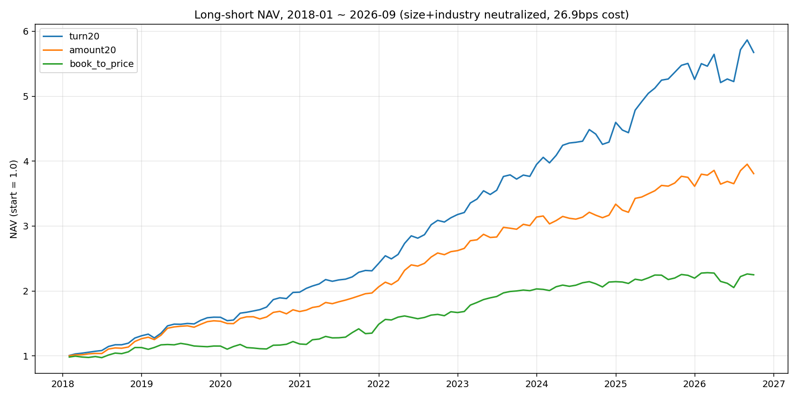

# A股量化工作台 · 回测报告

**最优结果：turn20（低换手）多空组合，2018-01 ~ 2026-09，年化 22.4%，夏普 1.93，最大回撤 -10.6%。**

全历史 1499 只 A 股 × 447 周，市值+行业双重中性化，周频调仓，双边成本 26.9bps。未接入任何交易通道，不构成投资建议。



## 一、核心结果

| 版本 | 年化 | 夏普 | 最大回撤 | 说明 |
|---|---:|---:|---:|---|
| **turn20 多空（理论最优）** | **22.43%** | **1.93** | -10.6% | 未做停牌/涨跌停过滤 |
| turn20 多空（可交易过滤后） | 19.42% | 1.78 | -10.2% | 剔除停牌、涨跌停、次新 |
| 复合 3 因子多空 | 18.63% | 1.73 | -9.0% | turn20+amount20+book_to_price |
| amount20 多空 | 16.87% | 1.59 | -9.6% | 低成交额 |
| turn20 纯多头（相对全池等权） | 超额 6.77% | 1.47 | -4.8% | 绝对年化 17.1% |

熊市表现（沪深300 距 52 周高点回撤 >10%，共 207 周，占 46%）：turn20 多空 **熊市周年化 +21.0%**，高于牛市。

## 二、三个必须知道的边界

1. **容量 0.75 亿**（全池，单票不超 10% ADV）。换到 ADV≥1 亿池后容量 **10.4 亿**，超额从 6.77% 降到 6.04%（因子反而更强，IC -0.075 vs -0.062）
2. **alpha 主要在空头端**：多头腿 +6.1%，空头腿 -19.0%。纯多头 + 沪深300 期货对冲后年化约 **-1%**（贴水 4%/年），这套因子更适合当**负面清单**用
3. **熊市不要清仓**：把熊市周切成空仓，年化从 7.6% 掉到 3.0%

## 三、正式样本外回测（另一套口径）

训练 2018–2022 / 测试 2023–2025，800 只日频面板，T+1、整手、成本全计入：年化 **14.5%**、夏普 1.02、最大回撤 -17.5%、年化超额 +8.2%。


## 目录

```
reports/
  01-oos-2023-2025.md              正式样本外回测（14.5% / 夏普 1.02）
  02-full-history-2018-2026.md     全历史深度验证（10 节，含容量/对冲/负面清单）
  03-strategy-comparison.md        4 类策略 + 6 组参数扫描对比
charts/
  monthly_nav_2018_2026.png        最优结果净值图
  backtest_equity_2023_2025.png    正式 OOS 净值图
data/
  monthly_nav.csv                  8 因子 × 105 个月净值
  portfolio_summary.json           多空因子汇总
  negative_screen.json             负面清单验证结果
```

## 复现

```bash
./run_chain.sh                                                        # 因子→策略→回测→OOS
python3 scripts/portfolio_backtest_v2.py --start 2018-01-01 --end 2026-09-22   # 全历史多空
python3 scripts/hedge_overlay.py --run-dir generated/portfolio_liq1yi3 --index csi300   # 对冲
python3 scripts/negative_screen_test.py                               # 负面清单
```

## 解释边界

- 研究级回测，非生产级 PIT：缺公司行动台账、权威 ST/停牌表、容量冲击模型，生产门禁 **BLOCK**
- 多空依赖融券，券源与成本未计入
- 数据截至 2026-09-22；不构成投资建议
