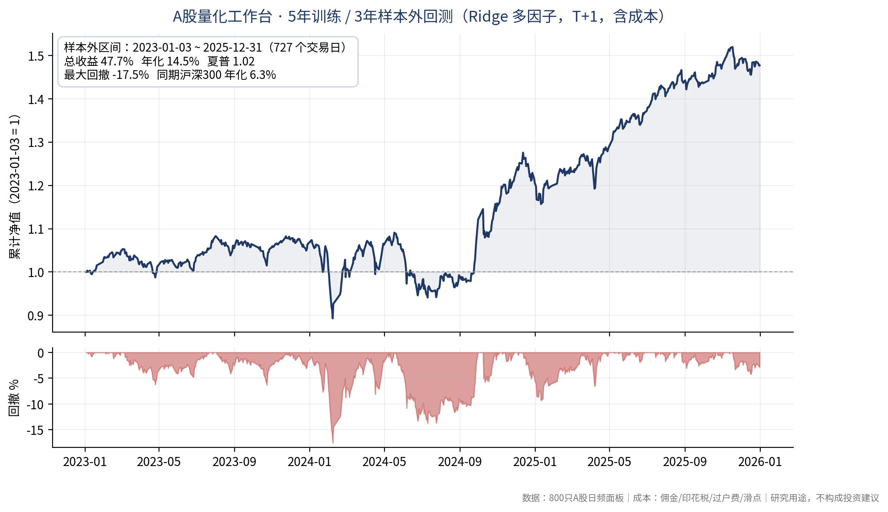

# A股量化工作台 · 样本外回测报告（2023–2025）

一套 A 股日频量化研究系统的样本外回测结果。训练与测试按时间严格切分，交易成本、T+1 与整手约束全部计入，未接入任何实盘交易通道。

**结论（2023-01-03 ~ 2025-12-31，727 个样本外交易日）**

| 指标 | 数值 |
|---|---|
| 总收益 | 47.7% |
| 年化收益 | 14.5% |
| 夏普比率 | 1.02 |
| 最大回撤 | -17.5% |
| 同期沪深300 年化 | 6.3% |
| 年化超额 | 8.2% |

## 口径与方法

- **数据**：800 只 A 股日频面板，1,684,041 行，2018-01-02 ~ 2026-09-18；真实未复权行情 + 累计后复权因子重建
- **切分**：训练 2018–2022（1,090 个交易日），测试 2023–2025（727 个交易日）；2026 从未进入测试
- **模型**：Ridge（alpha=100），训练期内嵌时间序列选参
- **执行**：T+1，按未复权开盘价成交，100 股整手；佣金、印花税、过户费、滑点均显式建模
- **可复现产物**：`report.json`、`equity.csv`（本地repo: `generated/formal_5y3y_backtest_20260922/`）

## 解释边界（重要）

- 这是**价格型研究回测**，不是生产级 PIT 回测：缺少完整公司行动台账、权威 ST/停牌状态表与容量冲击模型，因此生产门禁为 **BLOCK（research only）**
- 不构成投资建议，不代表实盘业绩；系统不含交易通道，所有信号需人工确认
- 同期最佳网格里的高收益单元未通过多重检验（Deflated Sharpe / BH-FDR / White SPA），本报告只呈现通过时间切分的主结果

## 相关

- 公开核心（通用回测引擎、Web 页面壳，MIT）：https://github.com/lhnblg2025-stack/comprehensive-quant-workbench
